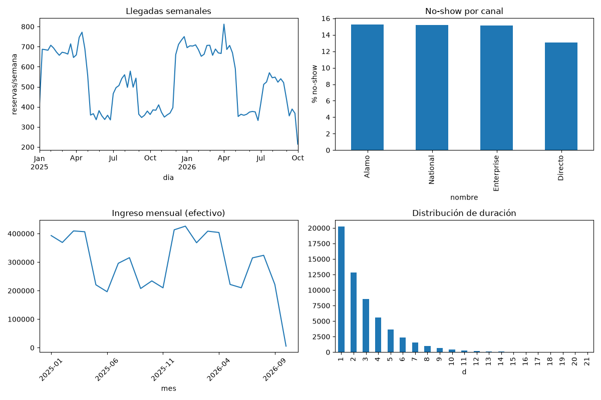
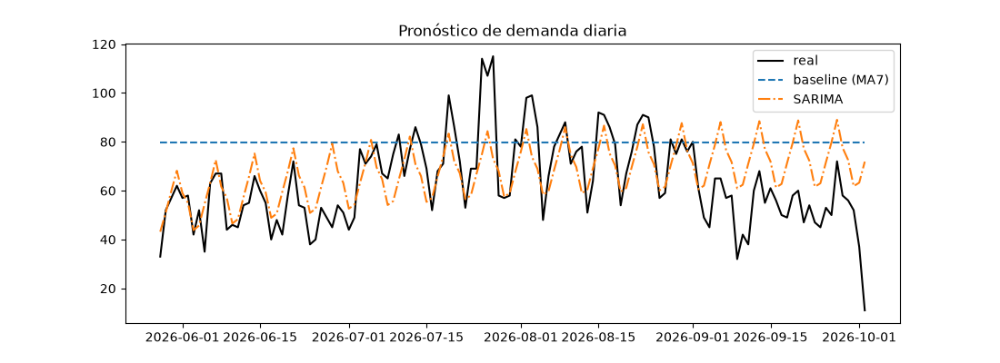
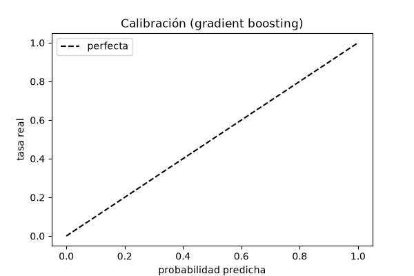

# 🚗 Motor de Inteligencia de Demanda y Operaciones — Rent-a-Car (SJO)

Proyecto de datos de extremo a extremo para una rent-a-car con operación en el
aeropuerto de San José (SJO), Costa Rica. Construido como carta de presentación
para roles de **Data Analyst / BI Analyst**.

> ⚠️ **Confidencialidad**: este repositorio usa datos **100% sintéticos**. La
> estructura, los códigos de clase de vehículo, las ubicaciones, los códigos de
> tarifa y los canales replican el patrón real del negocio, pero **no** contiene
> nombres, documentos, números de reserva ni placas reales. El dataset real
> jamás se publica.

---

## 1. El problema de negocio

La rent-a-car pierde dinero en tres frentes que un analista puede medir y
anticipar:

1. **¿Cuánta demanda habrá?** — Saber cuántas llegadas esperar por día y
   categoría permite dimensionar flota y personal.
2. **¿Quién no se presentará (no-show)?** — Un cliente que reserva y no llega
   deja el vehículo parado y pierde el ingreso.
3. **¿Dónde se pierde dinero?** — Utilización de flota, ingresos por reserva,
   cancelaciones tardías y horas pico de mostrador.

**Principio guía**: primero datos confiables, luego análisis, luego modelos.

## 2. Las tres preguntas y sus entregables

| Pregunta | Entregable | Técnica |
|---|---|---|
| ¿Cuánta demanda habrá? | Pronóstico de llegadas por día y categoría (temporada alta, feriados CR, Semana Santa) | Series de tiempo (SARIMA), validación temporal |
| ¿Quién no se presentará? | Probabilidad de no-show por reserva | Regresión logística + gradient boosting, métricas honestas |
| ¿Dónde se pierde dinero? | KPIs de ocupación, ingreso y no-show | SQL analítico + dashboard |

## 3. Arquitectura

```
data/raw/reservas_sinteticas.csv   ← generador (datos sintéticos)
        ↓  src/ingesta.py (ETL)
data/rentacar.db                   ← modelo estrella (SQLite)
        ↓  src/analisis.py, src/modelo_*.py
data/processed/*.png               ← gráficos y métricas
        ↓  dashboard/app.py (Streamlit)
README + caso de negocio
```

- **Ingesta y limpieza (Python)**: `src/generar_datos.py` + `src/ingesta.py`.
- **Base de datos**: SQLite con modelo dimensional (tabla de hechos de reservas
  + dimensiones de fecha, vehículo, ubicación, tarifa, canal y cliente).
- **Análisis y modelos (Python)**: KPIs, pronóstico de demanda y clasificación
  de no-show.
- **Dashboard**: Streamlit con vista ejecutiva y operativa.
- **Documentación**: README, diagrama, diccionario de datos y caso de negocio.

## 4. Estructura del repositorio

```
rentacar-sjo-demand-intelligence/
├── data/
│   ├── raw/          # CSV sintético (generado, no versionado)
│   └── processed/    # gráficos y salidas (generados)
├── sql/
│   ├── schema.sql        # modelo dimensional
│   ├── validaciones.sql  # checks de calidad de datos
│   └── kpis.sql          # consultas analíticas
├── src/
│   ├── generar_datos.py  # generador sintético
│   ├── ingesta.py        # ETL a SQLite
│   ├── analisis.py       # EDA + KPIs
│   ├── modelo_no_show.py # clasificación de no-show
│   └── modelo_demanda.py # pronóstico de demanda
├── dashboard/
│   └── app.py            # Streamlit (ejecutiva + operativa)
├── notebooks/            # exploración (opcional)
├── docs/                 # problema, arquitectura, caso de negocio, relato
├── requirements.txt
└── README.md
```

## 5. Cómo ejecutarlo

```bash
# 1. Entorno
python3 -m venv .venv
source .venv/bin/activate
pip install -r requirements.txt

# 2. Generar datos sintéticos (57k+ reservas)
python3 src/generar_datos.py

# 3. Cargar a la base de datos (modelo estrella)
python3 src/ingesta.py

# 4. Análisis y KPIs
python3 src/analisis.py

# 5. Modelos
python3 src/modelo_no_show.py
python3 src/modelo_demanda.py

# 6. Dashboard
streamlit run dashboard/app.py
```

## 6. Resultados resumidos

- **Demanda**: SARIMA reduce el error del baseline (MAE 11.9 vs 20.0
  llegadas/día; MAPE 24% vs 42%).
- **No-show**: AUC ≈ 0.69. Las variables más relevantes son el **contacto
  previo al cliente** y la **anticipación** de la reserva (consistente con la
  intuición de negocio).
- **KPIs**: tasa de no-show global ~15%, con diferencias por canal y por
  anticipación. El no-show representa un ingreso perdido medible en dólares.

### KPIs



### Pronóstico de demanda



### Calibración del modelo de no-show



## 7. Limitaciones honestas

- Los datos son sintéticos: los patrones son realistas pero no sustituyen la
  calibración con datos reales.
- El pronóstico usa SARIMA sobre una sola serie agregada; una versión por
  categoría de vehículo mejoraría la utilidad operativa.
- El modelo de no-show tiene recall limitado a umbrales bajos; en producción
  conviene optimizar el punto de operación según el costo de un falso positivo
  vs. un falso negativo.

## 8. Siguientes pasos

- Pronóstico desagregado por categoría de vehículo.
- Incluir Semana Santa y feriados como regresores explícitos en el modelo.
- Migrar SQLite → PostgreSQL y añadir dbt para el modelo dimensional.

Ver [docs/](docs/) para el caso de negocio, el relato de entrevista y el
diccionario de datos completo.
